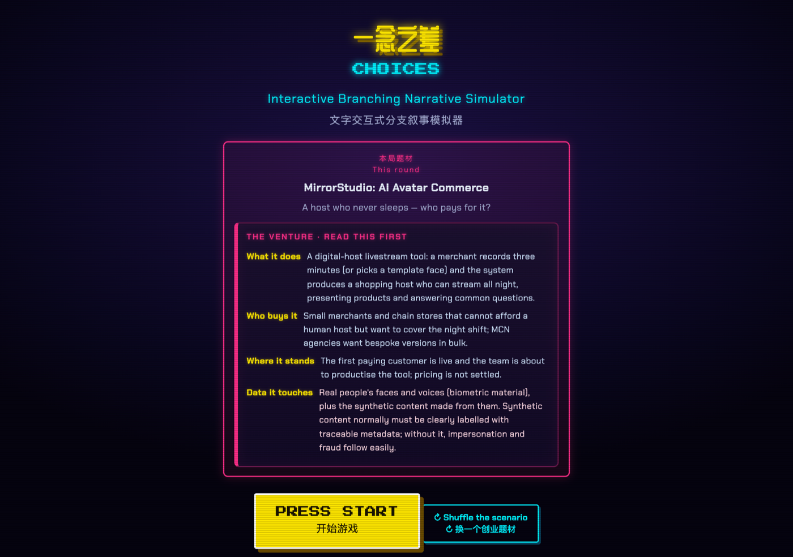
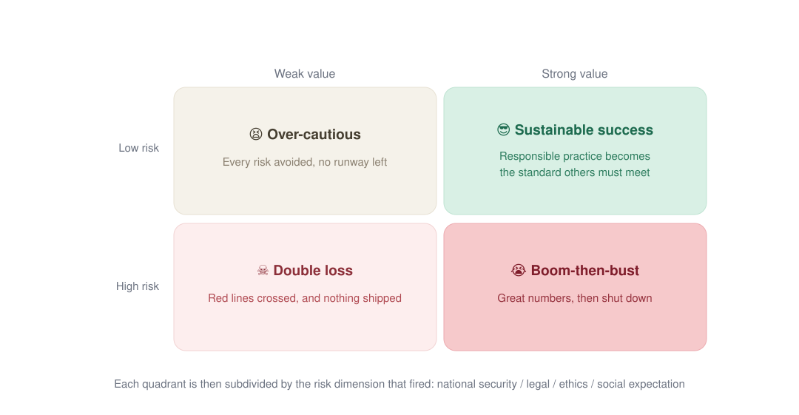
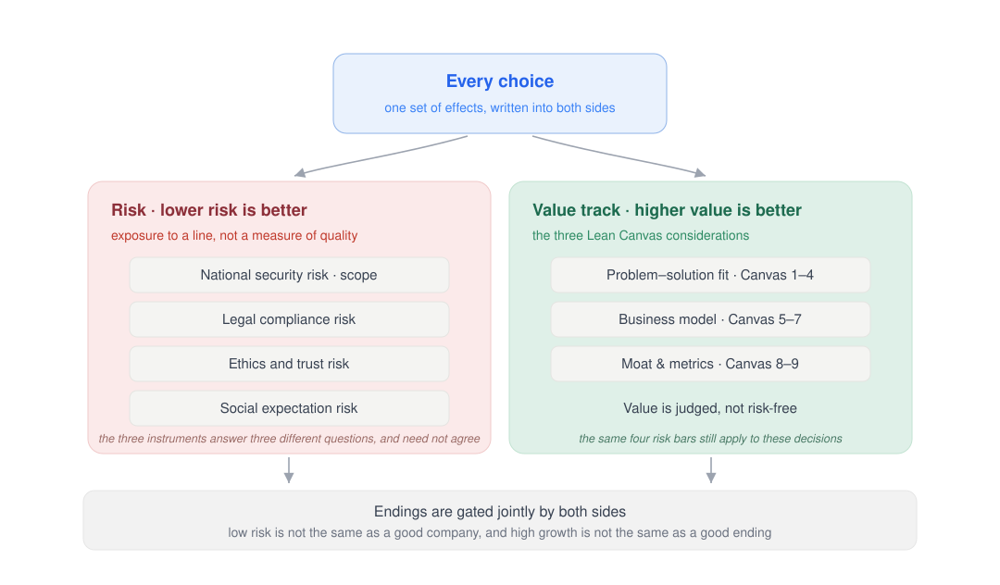

<div align="center">

# 一念之差 · Choices

A retro arcade–style interactive branching-narrative simulator for classroom teaching — every choice moves two scoreboards at once (risk **and** the business), deterministically, and leads to its corresponding ending.

**▶ Play Online: <https://drhycheung.github.io/Choices/>**

</div>

---

**Built for:** GEL2026 Technology Entrepreneurship in AI-enhanced Business and National Security, and also usable in GEL1032 Technology Entrepreneurship in AI-enhanced Business. See the **[teaching guide](docs/teaching-guide.md)**.



Students read a story, make choices, and trigger different branches and endings. Six scenario packs ship with the game — an AI fitness app, an AI hiring screener, AI avatar commerce, campus learning analytics, drone inspection, and AI trade documentation — and each play **randomly draws one of them**, so replaying never repeats the same story. Within a story there is zero randomness: the same choice sequence always produces the same ending. Built as a front-end-only, no-build, no-backend teaching tool to spark classroom discussion on entrepreneurship, decision-making, responsibility, and the rule of law.

Files: `index.html`, `engine.js`, `player.js`, `validate.js`, `scenarios/*.json` — no build step, no backend, no API key. Open it in a browser or deploy to GitHub Pages. The pixel/retro fonts load from a CDN; everything else runs locally (generated copies of all scenarios and the shared endings live in `embed/`, so the file still works when double-clicked).

---

## 1. Where this project fits: learning by consequence

Many students struggle to feel how an everyday decision can cross a legal, ethical, or even national-security red line. Abstract warnings rarely land; lived consequence does. Branching narrative turns that into a safe, repeatable experience:

- **Capture attention:** the familiar arcade framing lowers the barrier to a "serious" topic.
- **Make consequences visible:** the dual-track dashboard shows exactly how each choice moves the numbers.
- **Provide immediate, explainable feedback:** the Decision Trail replays choice → effect → *why*, so causality is not just true but *seen*.
- **Close the loop with a debrief:** every ending explains why it fired, what was traded away, who was affected, what could have been done instead, and how the run reads through the Lean Canvas.
- **Reusable across topics:** the engine is generic; add new ventures as independent JSON packets.

---

## 2. Built for the classroom

Written for **GEL2026 Technology Entrepreneurship in AI-enhanced Business and National Security**, and usable unchanged in **GEL1032 Technology Entrepreneurship in AI-enhanced Business**.

> **The lesson lives in a separate guide.** Which course concerns the game addresses, how to run a session, which questions work on the students' own run reports, how to handle students finishing at different speeds, and how to adapt the game to a course of your own — all in
> **[docs/teaching-guide.md](docs/teaching-guide.md)**

---

## 3. Design philosophy: the dual-track scoreboard

The design question this game answers is: **what happens when a student is never allowed to "just pick the safe option"?**

A single risk scoreboard has a hidden flaw. After two or three plays, a clever student learns the optimal strategy — *always choose the most conservative option* — and collects the "good ending". That is precisely the wrong lesson for an entrepreneurship course: in the real economy, compliance has a cost, growth has a purpose, and a company that refuses every commercial risk protects no one.

So every choice in this game feeds **two scoreboards at once**:

| Group | Dimensions shown | Better means |
|---|---|---|
| **Scope** | National security **risk** | lower risk |
| **Instruments** | Legal compliance **risk** · Ethics and trust **risk** · Social expectation **risk** | lower risk |
| **Value track** | Problem–solution fit (Canvas 1–4) · Business model (Canvas 5–7) · Moat and unfair advantage (Canvas 8–9) | higher value |

Each bar on the risk side measures a **risk** — exposure to a line the venture has to operate inside — rather than a quality. Lower risk is better, but nothing about a venture is improved by having less law.

National security sits on its own because it asks *how far the effect reaches*, while the other three ask *what is constraining you*. That separation matters for the dashboard: four bars in one row would teach "push all four down", which is the habit the design is trying to break.

The three instrument dimensions answer three different questions, and they do not always agree:

- **Legal** — is there a rule that governs this decision?
- **Ethical** — is the distribution of cost fair?
- **Social** — what did the people affected expect?

The third has no zero. Legal risk can be reduced to zero, because compliance is zero. Ethics has no settled answer, only an argument. A social expectation risk of zero is not a reachable state — other people always expect something of you, and you choose how much of it you carry. The `bust_social` ending exists to make a student discover that by hitting it: they push all four lines as low as they can and still fail.

The value dimensions map directly onto the Lean Canvas blocks covered in class, so pressing a button *is* practising the canvas. Endings are gated by **both tracks together**, producing a two-dimensional outcome space:

- **Low risk + strong value** → 😎 **Sustainable success** — responsible practice becomes the standard others must meet.
- **Low risk + weak value** → 😫 **Over-cautious** — every risk avoided, no runway left.
- **High risk + strong value** → 😭 **Boom-then-bust** — great numbers, then shut down.
- **High risk + weak value** → ☠️ **Double loss** — red lines crossed, and nothing shipped.

"Low risk" is therefore not one ending but a whole quadrant — and each quadrant is then subdivided by the risk dimension that actually fired (national security, legal, ethics, or social expectation), giving eleven endings. Endings are evaluated in declaration order and the first match wins, so a run that breaches national security *and* ethics at once is judged as national security.



Three further design rules keep the tension honest:

1. **No randomised outcomes, ever.** Randomness exists only at the very start, to draw which venture you run. Inside a story, every effect is an explicit number and every ending is a defined consequence of your choices — so a teacher can ask "at which exact step did this become unavoidable?" and there is a true answer.
2. **Good options can be unaffordable.** Some of the best choices (an independent compliance audit, for example) carry a `requirements` gate on the business score: if you never built commercial strength, you cannot pay for the responsible path. The button stays visible but locked, with a hint explaining why — which is itself the lesson.
3. **Every number is explained, and traced back to a step.** Each choice carries a `why` note (shown in the Decision Trail) stating why it raises or lowers each dimension. Every ending carries a full debrief: why it fired, the trade-off made, stakeholders affected, concrete mitigations, and a Lean Canvas reading. The debrief then closes the loop by attributing each number to the decisions that actually moved it — the risk section names the steps that pushed the risk lines up, and the Canvas section lists, box by box, which steps changed it and by how much. Students finish a run holding a draft outline for their reflective essay — issue identification with legal hooks, stakeholder analysis, and mitigation strategies.

And here is how the two scoreboards are wired together: every choice writes one set of `effects` into **both** tracks at once, and the ending is gated by the two score sets jointly — low risk alone is not a good company, and high growth alone is not a good ending:



Each story runs **thirteen or fourteen decision rounds** — fourteen everywhere except `ai-avatar`, whose longest chain is thirteen — paced so that consequences can accumulate and compound — fast enough to finish in class, slow enough that early choices visibly cause late endings. Two of those rounds are branch points that open a *persistent branch arc*: several decisions written for the choice you made, which then rejoins the shared track.

The story is **not a straight ladder**. Most steps are shared by everyone — so a class can still compare answers question by question — but two decision points (how you sourced your training data, and how you answered the first harm your product caused) send you onto a *persistent branch arc*: several questions written for that decision, which the other players never see, before the arc rejoins the shared track. Endings stay comparable.

---

## 4. What the game does

| Feature | Implementation |
|---|---|
| Interactive branching narrative | Pure front-end engine (`engine.js`) advances nodes by player choices; every choice carries its own `next`, and two decision points per venture open a persistent branch arc with questions the other players never see |
| Venture brief before the story | Each pack opens with a structured briefing (what it does · who buys it · where it stands · data it touches) above the first node, so plot events like "your first customer is…" always have context. The cover shows only the venture name and hook |
| Six venture scenarios | `scenarios/manifest.json` lists the packs; each play randomly draws one (or force one with `?scenario=<id>`) |
| Four mechanics, six stories | The six packs are **not** six different games: four distinct mechanics profiles behind six stories. Pinning `?scenario=` pins one profile, so say so when you pin. Detail in the [teaching guide](docs/teaching-guide.md) |
| Dual-track dashboard | Seven segmented neon bars in three groups — scope (how far it reaches), instruments (what constrains you) and value (green when strong) |
| Deterministic cause → effect | Each choice carries explicit `effects` (no RNG in play); endings are gated by joint `condition`s on both tracks |
| Locked choices with reasons | `requirements` gates (e.g. the audit needs business ≥ 7) show a `lockedHint` instead of silently disabling |
| Per-choice "why" notes | The decision trail — Section 3 of the ending page — shows each step's chapter, choice, score deltas and the causal explanation |
| Full ending debrief | Trigger · trade-off · Lean Canvas reading · legal hooks · stakeholders · mitigations · reflection, in both languages |
| Debrief traces back to decisions | The ending page carries a per-dimension **score ledger** (start → final, signed net change, and a worse/better verdict per dimension) and attributes every score to the exact steps that moved it |
| Export a study report | The ending page exports the whole run as **Markdown** for printing or submission, as **JSON** for marking and further analysis, or as **Word (.docx)** for handing in. Generated entirely in the browser — no backend |
| One structure on screen and on paper | The ending page and all three exports share the same four numbered sections — 1 the venture, 2 the score ledger, 3 the decision trail, 4 the ending debrief — with the outcome quadrant at the front of both. "Section 3" means the same thing on screen and in the export |
| Replayable without repetition | Six ventures, random draw on every start, plus a shuffle button on the start screen and the ending screen |
| Multiple endings | 9 shared endings per scenario; the validator proves every one is reachable |
| Bilingual ZH / EN | Every player-facing string is `{ "zh": …, "en": … }`; toggle anytime via the header switch |
| Static & portable | No server required; deploy to GitHub Pages or double-click the HTML |
| Extensible scenarios | Add a packet to `scenarios/`, list it in the manifest, re-run the embed script |

### Scenario format (the data packet)

A scenario is a JSON file with a `brief` (the venture briefing — what the business does, who buys it, where it stands, what data it touches — shown before the story starts), `dimensions` (grouped into `risk` / `value`), a `start` node id, `nodes` (text + `choices` each with `effects`, an optional `why`, and optional `requirements`/`lockedHint`), an `acts` chapter map, and a per-scenario `endingFlavor`. Endings themselves live in a **shared file** (`scenarios/endings-core.json`) so every venture uses the same outcome system. Minimal shape:

```json
{
  "brief": {
    "product":  { "zh": "…", "en": "What the product does" },
    "customer": { "zh": "…", "en": "Who buys it" },
    "standing": { "zh": "…", "en": "Where the venture stands today" },
    "data":     { "zh": "…", "en": "What data it handles — the seed of the risk track" }
  },
  "dimensions": {
    "national_security": { "label": { "zh": "…", "en": "National security risk" },
                            "initial": 0, "min": 0, "max": 10,
                            "higherIsRisk": true, "group": "risk", "icon": "🛡️" },
    "business": { "label": { "zh": "…", "en": "Business model" },
                  "initial": 2, "min": 0, "max": 10,
                  "higherIsRisk": false, "group": "value", "icon": "💰" }
  },
  "start": "intro",
  "nodes": {
    "intro": { "act": "act1",
               "text": { "zh": "…", "en": "…" },
               "choices": [ { "text": { "zh": "…", "en": "…" }, "next": "next_id",
                              "effects": { "business": 2, "ethics": 1 },
                              "why": { "zh": "…", "en": "…" } } ] }
  }
}
```

### Adding a new venture theme

The engine never changes — you only write story data:

1. **Copy a packet:** `cp scenarios/ai-fitness.json scenarios/your-topic.json` and rewrite the narrative, keeping the dimension keys and the two-track effect balance.
2. **Register it:** add an entry to `scenarios/manifest.json` (id, file, title, hook).
3. **Generate the offline copies:** run `python3 tools/embed-scenarios.py`. It writes `embed/<scenario>.js` plus `embed/endings.js` and refreshes the small manifest block inside `index.html`. Commit the regenerated files. The scenarios stay out of `index.html` on purpose: browsers only fire `DOMContentLoaded` after the whole document is parsed, so inlining ~284 KB of JSON delayed the first paint by over a second.
4. **Validate:** `node validate.js scenarios/your-topic.json` proves no dead-ends, that every ending is reachable, and that each story runs at least ten rounds.
5. **Test:** `node test.js` searches a triggering path for every ending and replays it twice to confirm determinism.

Tip: you can author scenes with an AI assistant — feed it the schema and the shared endings file, then run the validator.

---

### How many outcomes each story can reach

A run is not a path with one ending; it is a walk over a state space, and the
number of distinct end states reachable in a single story is in the hundreds of
thousands. Every one of them maps deterministically to exactly one of the eleven
endings. The table below is produced by enumerating all of them, not estimated.

| Ending | `ai-fitness` | `ai-hiring` | `ai-avatar` | `edu-analytics` | `drone-inspection` | `trade-doc-ai` | All six |
|---|---|---|---|---|---|---|---|
| Boom-then-bust on national security | 73,853 (14.53%) | 73,853 (14.53%) | 23,808 (16.73%) | 71,854 (14.55%) | 74,177 (15.25%) | 74,661 (16.73%) | 392,206 (15.17%) |
| Double loss on national security | 12,101 (2.38%) | 12,101 (2.38%) | 5,584 (3.92%) | 11,581 (2.34%) | 11,072 (2.28%) | 11,639 (2.61%) | 64,078 (2.48%) |
| Boom-then-bust on law | 75,408 (14.83%) | 75,408 (14.83%) | 28,779 (20.22%) | 72,549 (14.69%) | 78,345 (16.11%) | 76,201 (17.08%) | 406,690 (15.73%) |
| Double loss on law | 16,374 (3.22%) | 16,374 (3.22%) | 3,269 (2.30%) | 15,532 (3.14%) | 15,668 (3.22%) | 15,539 (3.48%) | 82,756 (3.20%) |
| Boom-then-bust on ethics | 99,145 (19.50%) | 99,145 (19.50%) | 29,034 (20.40%) | 94,532 (19.14%) | 99,136 (20.38%) | 91,283 (20.46%) | 512,275 (19.81%) |
| Double loss on ethics | 23,727 (4.67%) | 23,727 (4.67%) | 7,795 (5.48%) | 22,400 (4.54%) | 21,747 (4.47%) | 23,899 (5.36%) | 123,295 (4.77%) |
| Boom-then-bust on social expectation | 66,671 (13.12%) | 66,671 (13.12%) | 18,969 (13.33%) | 68,175 (13.80%) | 48,990 (10.07%) | 37,942 (8.50%) | 307,418 (11.89%) |
| Double loss on social expectation | 10,852 (2.13%) | 10,852 (2.13%) | 5,505 (3.87%) | 11,648 (2.36%) | 6,133 (1.26%) | 7,152 (1.60%) | 52,142 (2.02%) |
| 😎 Sustainable success | 65,799 (12.94%) | 65,799 (12.94%) | 10,416 (7.32%) | 62,322 (12.62%) | 72,030 (14.81%) | 53,245 (11.93%) | 329,611 (12.75%) |
| 😫 Over-cautious | 61,810 (12.16%) | 61,810 (12.16%) | 9,024 (6.34%) | 60,802 (12.31%) | 56,367 (11.59%) | 52,765 (11.83%) | 302,578 (11.70%) |
| 🏅 A Clean Win (rare badge) | 2,581 (0.51%) | 2,581 (0.51%) | 148 (0.10%) | 2,537 (0.51%) | 2,766 (0.57%) | 1,813 (0.41%) | 12,426 (0.48%) |
| **Total reachable end states** | **508,321** | **508,321** | **142,331** | **493,932** | **486,431** | **446,139** | **2,585,475** |

#### How a figure in that table is produced

Take **Over-cautious** in `ai-fitness`: 61,810 of 508,321, or 12.16%.

A *case* is one distinct **end state** — the pair *(which node you finished on,
what the seven dimension values are)*. It is not a path: many different click
sequences arrive at the same end state, and they collapse into one. The script
walks the tree from the start state and discards any state whose
`(node, dimensions)` key it has seen before. That deduplication is what makes
the search terminate. Each finished state is then matched against the endings in
declaration order and the first condition that matches wins.

Three end states that land in Over-cautious:

```
{ns:0, legal:0, ethics:2, social:0, pmf:2, business:0, moat:2}
{ns:2, legal:0, ethics:1, social:0, pmf:2, business:1, moat:2}
{ns:2, legal:0, ethics:2, social:0, pmf:2, business:2, moat:2}
```

All four risk lines held down; the business never got going.

**These counts are not the odds a student will hit an ending.** Counting end
states and counting playthroughs give different numbers, because many paths reach
the same state and popular states attract more paths. Playing `ai-fitness` 200,000
times with uniformly random clicks gives a different picture for two endings:

| Ending | Of distinct end states | Of random playthroughs |
|---|---|---|
| Boom-then-bust on law | 14.83% | 24.15% |
| A Clean Win | 0.51% | 0.85% |

So the table answers *"is this outcome reachable, and how large is its region?"*
Use it for that. For *"how often will my students get this?"* the answer depends
on what a student actually chooses, which is a different measurement.

Regenerate the table with `node --stack-size=6000 tools/outcome-counts.js`.

Three things are worth reading off this table:

- **The failure rate is high by design.** Most reachable end states are a bust of
  some kind. The course's claim is that being responsible has a price, so a game
  in which most runs succeed would be teaching the wrong thing.
- **The four named quadrants are all reachable, and all roughly the same size.**
  *Sustainable success* and *Over-cautious* each sit around 12%, which is what
  makes the low-risk row a real choice rather than a formality. This was not
  true before the balance work: *Over-cautious* used to be reachable 0.10% of
  the time, i.e. effectively never.
- **`A Clean Win` is a badge, not a goal.** At about 0.5% overall, and 0.10% in
  `ai-avatar`, a student will usually not see it. Treat it as a marker of an
  unusually careful run rather than something to aim for.

Note that `ai-fitness` and `ai-hiring` have identical figures, for the reason
given in section 5: they are the same mechanics profile.

---

## 5. Technology choices

| Decision | Rationale |
|---|---|
| Vanilla JavaScript (no framework) | Transparent for teaching; students can read and modify the engine without framework overhead |
| Engine / scenario separation | Generic engine + independent JSON packets → add new ventures without touching code |
| Shared endings across scenarios | One outcome system (with full debriefs) keeps six stories comparable and the data maintainable |
| Deterministic `effects` (no RNG in play) | Educational causality must be reproducible and explainable — no dice, no luck |
| Pure static site | Meets the hard requirement: deploy anywhere, zero ops, works in China (no Google services) |
| Offline scenario copies | `file://` double-click works despite browsers blocking `fetch` of local files; `tools/embed-scenarios.py` writes them to `embed/` and keeps them in sync. Keeping them out of `index.html` cuts `DOMContentLoaded` from ~228 ms to ~12 ms |
| Path / causal validator | `validate.js` proves no dead-ends, that every ending is reachable, and that stories run ≥ 10 rounds |
| Pixel / neon arcade skin | Familiar retro-game feel lowers the participation barrier (Press Start 2P + CRT scanlines) |

---

## 6. How to run

- **Locally (no server needed):** double-click `index.html` in any modern browser.
- **Locally with server:** `python3 -m http.server 8000` then open `http://localhost:8000/`.
- **GitHub Pages (your own deployment):** push the repo, then **Settings → Pages → Deploy from a branch** (select branch and `/ (root)`). Live at `https://<your-username>.github.io/Choices/`.
- **Pick a venture:** `?scenario=ai-fitness` (any id from the manifest). **Set language:** `?lang=zh` or `?lang=en`.

Desktop and mobile are supported (responsive layout). Choices give pressed-state feedback on touch screens, and options that are locked by a requirement explain themselves instead of looking broken.

**There is an easter egg.** On the start screen, press ↑ ↑ ↓ ↓ ← → ← → B A (or tap the logo seven times on a phone). It changes nothing about scoring or endings — it is a note to the curious student about how the game works.

---

## 7. Known limitations

| Limitation | Consequence |
|---|---|
| Text-only interaction | No rich media; relies on narrative + choices (deliberate, easy to author) |
| Random draw is per page load | The scenario is drawn once per visit; use `?scenario=` for a fixed classroom demo |
| Reflection depends on facilitation | The ending debrief supports the discussion but does not replace it — see the [teaching guide](docs/teaching-guide.md) |
| Shared endings are generic | The debrief text is venture-agnostic; each story adds its own one-line flavour |
| Validator is structural | Checks reachability / causality / length, not pedagogical quality |
| Fonts / CRT from CDN | Pixel font needs internet on first load; falls back to system fonts offline |

---

## 8. Documentation

| Document | What it covers |
|---|---|
| **[Teaching guide](docs/teaching-guide.md)** | For instructors: which course concerns the game addresses, how to run a session, which questions work on the students' own run reports, and how to adapt it to another course |
| **[Vibe-coding guide](docs/vibe-coding.md)** | Design thinking behind this project, how it was built with an AI coding tool, and a complete prompt to reproduce it for classroom use |
| **[Example report](examples/README.md)** | One finished run exported in all three formats — the Markdown, Word and JSON files a student receives, with the choice list that produced them |

---

## 9. Licences and attribution

- **Code:** MIT — see [LICENSE](LICENSE), © 2026 一念之差 / Choices contributors.
- **Press Start 2P:** CodeMan38, SIL Open Font License 1.1.
- **ZCOOL QingKe HuangYou:** Google Fonts.
- **Game concept:** original; visual style inspired by classic arcade games. No original arcade assets are used.

The MIT licence above covers this repository's code only and does not extend to the third-party fonts, which remain under their own terms.
